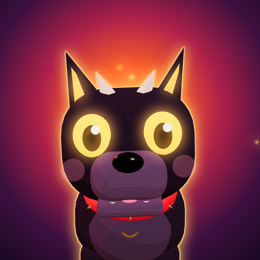
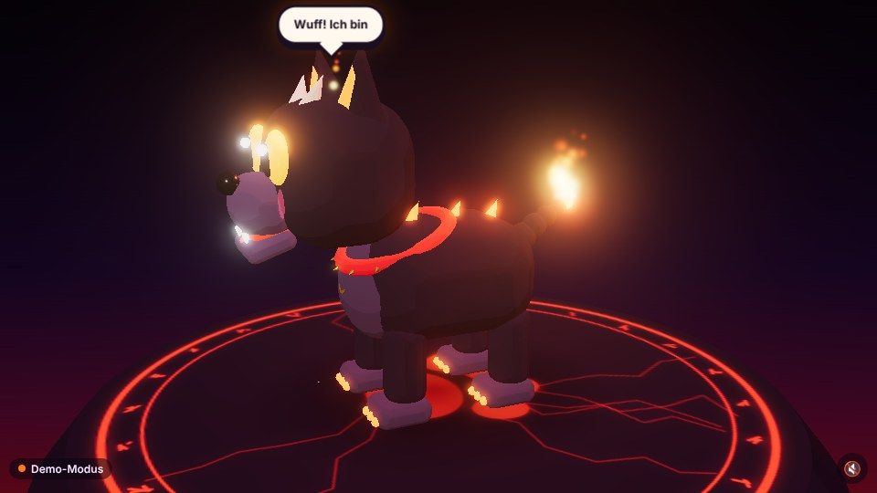
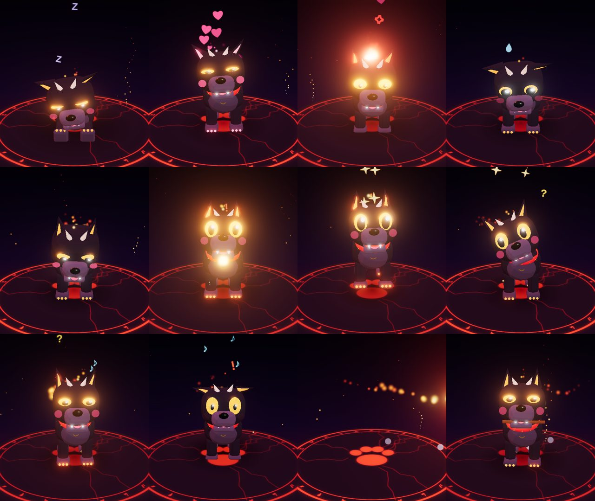

# 🔥 Klotzi – der süßeste Höllenhund auf Discord 🐾

Klotzi ist ein Discord-Bot mit eigenem **3D-Auftritt im Sprach-Call**. Er liest im Chat mit,
antwortet mit Hilfe der **OpenAI-API**, reagiert spontan auf Nachrichten – und zeigt seine
Gefühle live als animierter Höllenhund im Call: wedeln, bellen (mit Feuer!), schlafen,
Stöckchen holen, Herzchen, Wutflammen …

Seine Fähigkeiten sind **Skills**: kleine Module, die man einfach in einen Ordner legt.





---

## Wie kommt ein 3D-Hund in den Call?

Discord-Bots können keine Kamera und keine Bildschirmübertragung senden. Der offizielle Weg,
interaktive Inhalte in einen Sprach-Call zu bringen, sind **Discord Activities** (Embedded Apps).
Klotzi besteht deshalb aus zwei Teilen, die über einen WebSocket verbunden sind:

```
 Discord-Chat ──► Bot (discord.js) ──► OpenAI (Antwort + Tool-Aufrufe der Skills)
                      │
                      │  "Bühne": animate / say / thinking  (WebSocket)
                      ▼
 Sprach-Call ──► Activity (Three.js) ──► Klotzi in 3D für alle im Call
                      │
                      └─► Klick auf Klotzi = streicheln (zurück an den Bot)
```

Jeder im Call startet Klotzi über den **Aktivitäten-Button (🚀)** und sieht dieselbe Show.
Zusätzlich setzt sich Klotzi von selbst zu euch in den **Sprach-Channel** (Skill `voice`):
Dort ist er als Mitglied sichtbar und bellt, jault und knurrt hörbar für alle – auch für die,
die die Activity gerade nicht offen haben.
Alternativ läuft die Bühne auch als **Browser-/OBS-Overlay** (siehe unten).

| Ordner      | Inhalt                                                                      |
| ----------- | --------------------------------------------------------------------------- |
| `bot/`      | Discord-Bot, OpenAI-„Gehirn“, Skill-System, HTTP-/WebSocket-Server          |
| `activity/` | Die 3D-Activity (Vite + Three.js + Discord Embedded App SDK)                |
| `shared/`   | Gemeinsames Protokoll (Animationen, Events) für Bot und Activity            |

Klotzi selbst ist **komplett prozedural** aus abgerundeten „Klötzen“ gebaut (daher der Name):
kein 3D-Modell zum Herunterladen, jedes Körperteil ist ein eigenes Gelenk. Toon-Shading,
Bloom-Leuchten, Partikelfeuer, schwebende Symbole und synthetisierte Bell-Geräusche
(Web Audio) sind alle im Code.

---

## Schnellstart

Voraussetzung: **Node.js ≥ 22.4**

```bash
npm install
cp .env.example .env   # ausfüllen, siehe unten
npm run build          # Activity bauen
npm start              # Bot + Bühne starten (Port 3001)
```

Nur die 3D-Animation ansehen, ganz ohne Discord: `npm run dev:activity` und
http://localhost:5173 öffnen – dort läuft ein **Demo-Modus**. Mit den Tasten
`1`–`0`, `q`, `w`, `e`, `r` lassen sich alle Animationen auslösen, `t` = Nachdenken,
`s` = Sprechblase. Mit der Maus folgt Klotzi deinem Zeiger, ein Klick streichelt ihn.

### 1. Discord-App einrichten

1. Im [Developer Portal](https://discord.com/developers/applications) eine App anlegen.
2. **Bot**: Token erzeugen → `DISCORD_TOKEN`. Den privilegierten Intent
   **Message Content Intent** aktivieren (sonst kann Klotzi den Chat nicht lesen).
3. **OAuth2**: Client-ID → `DISCORD_CLIENT_ID`, Client Secret → `DISCORD_CLIENT_SECRET`.
   Als Redirect `https://127.0.0.1` eintragen (wird von Activities verlangt, aber nicht benutzt).
4. Bot einladen: OAuth2 → URL Generator → Scopes `bot` + `applications.commands`,
   Rechte *Kanäle ansehen*, *Nachrichten senden*, *Links einbetten*, *Reaktionen hinzufügen*,
   *Nachrichtenverlauf lesen* sowie für den Sprach-Chat *Verbinden* und *Sprechen*.
   Fertiger Link (Rechte-Wert `3230784`):
   `https://discord.com/oauth2/authorize?client_id=<CLIENT_ID>&scope=bot+applications.commands&permissions=3230784`

5. **General Information → App Icon**: [`assets/icon-512.png`](assets/icon-512.png) hochladen
   (dasselbe Bild eignet sich auch als Bot-Avatar und als Activity-Cover).
   Unter **Bot → Banner** passt [`assets/banner-680x240.png`](assets/banner-680x240.png)
   (hochauflösend: [`assets/banner-1360x480.png`](assets/banner-1360x480.png)).

### 2. Activity aktivieren

1. **Activities → Settings**: Activities aktivieren (ggf. auch für Mobile).
2. **Activities → URL Mappings**: Root-Mapping `/` → die öffentliche Adresse deines Servers
   **ohne** `https://`, z. B. `klotzi.example.com`.
3. Discord legt automatisch einen *Entry-Point*-Command an. Klotzi lässt ihn beim Registrieren
   seiner eigenen Slash-Commands in Ruhe.

Zum lokalen Entwickeln braucht Discord eine öffentliche HTTPS-Adresse, z. B. mit einem Tunnel:

```bash
npm run dev                                        # Bot (3001) + Vite-Dev-Server (5173)
cloudflared tunnel --url http://localhost:5173     # Adresse als URL-Mapping eintragen
```

Der Vite-Dev-Server leitet `/api` und `/ws` an den Bot weiter. In Produktion liefert der Bot
die gebaute Activity selbst aus – dann zeigt das URL-Mapping direkt auf Port 3001.

### 3. OpenAI

`OPENAI_API_KEY` setzen. Klotzi nutzt die **Responses API** mit dem Modell `gpt-6-luna`
(über `OPENAI_MODEL` änderbar). Die Anfragen sind zustandslos (`store: false`): Verlauf und
Tool-Aufrufe werden jedes Mal mitgeschickt, das Reasoning des Modells wird verschlüsselt
zwischen den Tool-Runden weitergereicht. Mit `OPENAI_REASONING_EFFORT` (z. B. `low`) lässt sich
die Antwortzeit im Chat verkürzen. Über `OPENAI_BASE_URL` lassen sich kompatible APIs nutzen.

### Docker

```bash
docker build -t klotzi .
docker run --env-file .env -p 3001:3001 -v klotzi-data:/app/data klotzi
```

Fertige Images (linux/amd64) baut eine GitHub Action bei jedem Push nach `main` und
veröffentlicht sie in der GitHub Container Registry:

```bash
docker run --env-file .env -p 3001:3001 -v klotzi-data:/app/data ghcr.io/hakenadu/klotzi:latest
```

Neben `latest` gibt es zu jedem Commit ein Tag `sha-<kurzer-hash>`.

---

## Was Klotzi im Chat macht

| Situation                                                | Reaktion                                                                 |
| -------------------------------------------------------- | ------------------------------------------------------------------------ |
| Erwähnung, Antwort auf Klotzi, DM, „Klotzi“ irgendwo im Text (auch „Klotzis“, „Klotzilein“) | Liest den **ganzen Verlauf der letzten 24 Stunden** plus sein Gedächtnis, antwortet per OpenAI, spielt **immer** eine Animation (wählt das Modell keine, hüpft er fröhlich) |
| „Klotzi“ während des Cooldowns (3 s pro User)            | keine neue OpenAI-Anfrage, aber Klotzi hüpft im Call trotzdem             |
| Nachricht in einem `KLOTZI_CHAT_CHANNELS`-Kanal          | antwortet immer                                                          |
| eine der nächsten **2 Nachrichten** nach Klotzis eigener Antwort (ohne „Klotzi“) | **Nachlauschen**: die Decisions API prüft, ob sich die Nachricht noch auf ihn bezieht – wenn ja, antwortet er |
| beliebige andere Nachricht (Chance `KLOTZI_AMBIENT_CHANCE`) | spontane Reaktion: Emoji + Animation, selten ein kurzer Kommentar       |
| jede Nachricht                                           | Klotzi spitzt im Call kurz die Ohren                                     |
| während OpenAI rechnet                                   | Klotzi legt im Call nachdenklich den Kopf schief                          |

Seine Antworten erscheinen zusätzlich als **Sprechblase** über seinem Kopf (mit Mundbewegung).
Nach drei Minuten ohne Ereignis rollt er sich zusammen und schläft, bis wieder etwas passiert.

### Wer ist Klotzi?

Ein 5 Meter großer Höllenhund aus dem **Warp** – eine Fantasy-Kreatur aus einem Warhammer-40k-Universum.
Beschworen hat ihn der Psioniker **Manael** (im Chat `mseiche`), den Klotzi über alle Maßen lieb hat:
sein Herrchen und allerbester Freund. Die komplette Persona steht in
[`bot/src/core/persona.ts`](bot/src/core/persona.ts).

### Gedächtnis und Verlauf

- **Kurzzeitgedächtnis:** Für jede Antwort sieht Klotzi den kompletten Chatverlauf des Kanals der
  letzten `KLOTZI_HISTORY_HOURS` Stunden (Standard 24) mit Uhrzeiten. Der Verlauf wird beim ersten
  Mal pro Kanal über die Discord-API nachgeladen und danach live mitgeschrieben (inkl. Bearbeitungen
  und Löschungen). Obergrenzen: `KLOTZI_HISTORY_MAX_MESSAGES` (500) und `KLOTZI_HISTORY_MAX_CHARS` (60 000).
- **Langzeitgedächtnis:** Klotzi pflegt selbst eine `MEMORY.md` in `KLOTZI_DATA_DIR`
  (im Docker-Image im Volume `/app/data`), die Neustarts übersteht und in **jedem** Prompt steht.
  Mit den Tools `remember`, `revise_memory` und `forget_memory` legt er Erinnerungen mit einer
  Wichtigkeit (★ bis ★★★) an, frischt sie auf oder löscht sie. Die Datei ist lesbares Markdown und
  darf auch von Hand bearbeitet werden.
- **Vergessen:** Das Gedächtnis ist auf `KLOTZI_MEMORY_MAX_ENTRIES` Einträge (80) und
  `KLOTZI_MEMORY_MAX_CHARS` Zeichen (8 000) begrenzt. Wird es voll, wird die Erinnerung mit der
  geringsten Relevanz verdrängt – Relevanz = Wichtigkeit × 30 Tage − Tage seit der letzten Bestätigung.
  Alte Fakten aus dem früheren `memory.json` werden beim ersten Start automatisch übernommen.

### Nachlauschen

Nachdem Klotzi etwas geschrieben hat, hört er im selben Kanal noch die nächsten
`KLOTZI_FOLLOW_UP_MESSAGES` Nachrichten (2) mit – höchstens `KLOTZI_FOLLOW_UP_MINUTES` Minuten lang (15).
Für jede dieser Nachrichten fragt er die **OpenAI Decisions API** (`OPENAI_DECISION_MODEL`,
Standard `gpt-6-luna`) mit einer Ja/Nein-Frage (*predicate*), ob sie sich auf ihn bezieht. Liegt die
Wahrscheinlichkeit über `KLOTZI_FOLLOW_UP_THRESHOLD` (0,5), antwortet er – auch ohne dass sein Name fällt.
Jede Antwort öffnet das Lauschfenster neu.

### Mitgelieferte Skills

| Skill    | Kann                                                                                   |
| -------- | -------------------------------------------------------------------------------------- |
| `core`   | `/klotzi` – Vorstellung und Übersicht aller geladenen Skills                           |
| `emote`  | Tool `perform_animation`: das Modell wählt selbst die passende 3D-Animation            |
| `care`   | `/leckerli`, `/streicheln`, Streicheln per Klick im Call; merkt sich den Lieblingsmenschen |
| `fetch`  | `/stoeckchen` – Klotzi rennt im Call los und bringt das Stöckchen zurück                |
| `dice`   | `/wuerfeln` und Tool `roll_dice` (`d20`, `2d6+3`, …) mit echten Zufallszahlen          |
| `clock`  | Tool `get_time` für Uhrzeit und Datum in beliebigen Zeitzonen                          |
| `memory` | Tools `remember` / `revise_memory` / `forget_memory`: Klotzi pflegt seine `MEMORY.md`     |
| `image`  | Tool `generate_image`: Klotzi malt Bilder (`gpt-image-2.5-sunburst`) und hängt sie an seine Antwort, wenn danach gefragt wird oder es wirklich hilft |
| `voice`  | Geht automatisch in den Sprach-Channel, in dem die meisten sind, und verlässt ihn, wenn er leer ist; spielt dort die Geräusche zu seinen Animationen |

Der Voice-Skill braucht keine Audiodateien und kein FFmpeg: Die Geräusche werden wie in der
Activity synthetisiert, nur eben als PCM auf dem Server. Steuern lässt er sich mit
`KLOTZI_VOICE_CHANNELS` (nur diese Channel-IDs), `KLOTZI_VOICE_SOUNDS=false` (still dabeisitzen)
und `KLOTZI_VOICE_VOLUME` (0–1). Klotzi tritt stummgeschaltet für eingehendes Audio bei
(*self-deaf*) – er hört nicht mit. Ganz abschalten: `KLOTZI_DISABLED_SKILLS=voice`.

Der Bild-Skill nutzt die **OpenAI Images API** mit `OPENAI_IMAGE_MODEL` (Standard
`gpt-image-2.5-sunburst`) und `OPENAI_IMAGE_QUALITY` (Standard `medium`). Pro Antwort malt
Klotzi höchstens ein Bild, pro Kanal höchstens eins alle `KLOTZI_IMAGE_COOLDOWN` Sekunden (60).
Schickt das Modell einen Fehler zurück (z. B. Moderation), erfährt Klotzi das und antwortet ohne Bild.

Kommen bekannte Charaktere im Bild vor, schickt Klotzi ihre **Referenzbilder** über die
Edit API mit (`input_fidelity: high`), damit sie wiedererkennbar aussehen. Die Bilder liegen in
[`bot/characters/`](bot/characters) – **Dateiname = Name des Charakters** (z. B. `Gideon.png`).
Eigene Bilder lassen sich ohne neues Image in `data/characters/` ablegen (gleicher Name überschreibt).
Spitznamen und Hinweise fürs Malen (z. B. dass Shashangli alias Tana inzwischen weiße Haare hat)
stehen in [`bot/src/core/characters.ts`](bot/src/core/characters.ts).

Skills lassen sich mit `KLOTZI_SKILLS=dice,emote` (nur diese) oder
`KLOTZI_DISABLED_SKILLS=memory` (alle außer diesen) steuern.

---

## Eigene Skills schreiben

Jede Datei in [`bot/src/skills/`](bot/src/skills) wird beim Start automatisch geladen
(Dateien mit `_` am Anfang werden übersprungen – gut für Hilfsfunktionen).
Ein Skill kann beliebig viele dieser Bausteine kombinieren:

| Baustein    | Zweck                                                                                  |
| ----------- | -------------------------------------------------------------------------------------- |
| `prompt`    | Text (oder Funktion) für Klotzis System-Prompt, z. B. Wissen über den aktuellen User    |
| `tools`     | Funktionen, die das Sprachmodell selbstständig aufrufen kann (Function Calling der Responses API) |
| `commands`  | Slash-Commands                                                                         |
| `onMessage` | Hook für jede Chat-Nachricht; `true` zurückgeben = Nachricht ist erledigt              |
| `setup`     | einmalig beim Start, z. B. um auf Bühnen-Events (`pet`, `join`) zu hören                |

Über den Kontext hat jeder Skill Zugriff auf den Discord-Client, OpenAI, einen persistenten
JSON-Speicher (`ctx.store`), Klotzis Gedächtnis (`ctx.memory`) und die **Bühne** (`ctx.stage.animate(...)`, `ctx.stage.say(...)`).

Beispiel – ein Wetter-Skill (`bot/src/skills/weather.ts`):

```ts
import { defineSkill, defineTool } from '../core/skill.ts';

export default defineSkill({
  name: 'weather',
  description: 'Schnüffelt das Wetter für beliebige Orte.',
  prompt: 'Wenn jemand nach dem Wetter fragt, benutze das Tool "get_weather".',
  tools: [
    defineTool<{ city: string }>({
      name: 'get_weather',
      description: 'Aktuelles Wetter für eine Stadt',
      parameters: {
        type: 'object',
        properties: { city: { type: 'string' } },
        required: ['city'],
      },
      async execute({ city }, ctx) {
        const res = await fetch(`https://wttr.in/${encodeURIComponent(city)}?format=j1`);
        const data = await res.json();
        if (Number(data.current_condition[0].temp_C) > 30) ctx.stage.animate(ctx.guildId, 'happy'); // Hitze! 🔥
        return data.current_condition[0];
      },
    }),
  ],
});
```

Neustarten – fertig. Klotzi entscheidet selbst, wann er das Tool benutzt.

### Neue Animationen

1. Namen + Beschreibung in [`shared/src/index.ts`](shared/src/index.ts) (`ANIMATIONS`) eintragen –
   damit kennt auch das Sprachmodell die Animation.
2. In [`activity/src/klotzi/animations.ts`](activity/src/klotzi/animations.ts) eine Pose-Funktion
   ergänzen. Eine Animation liefert pro Frame nur die Werte, die sie ändern will
   (`headTilt`, `tailAmp`, `jaw`, `flame`, …); der Animator blendet weich dorthin und zurück.
   Effekte (Symbole, Feuerstöße, Geräusche) werden über `cues` und `every` zeitgesteuert ausgelöst.

---

## Browser- und OBS-Modus

Mit gesetztem `KLOTZI_OVERLAY_KEY` kann man Klotzi auch außerhalb von Discord zuschauen:

```
https://dein-host/?guild=<GUILD_ID>&key=<KLOTZI_OVERLAY_KEY>
```

Weitere Parameter: `transparent=1` (transparenter Hintergrund, z. B. als OBS-Browserquelle),
`hud=0` (ohne Statusanzeige), `quality=low` (ohne Bloom, für schwache Geräte).

## Sicherheit

- Die Activity meldet sich per Discord-OAuth an; der Server prüft das Token und ob der User
  wirklich Mitglied der Guild ist, bevor er Klotzis Auftritte dieser Guild sehen darf.
- Overlays brauchen den geheimen `KLOTZI_OVERLAY_KEY`.
- Cooldowns pro User und Kanal begrenzen die OpenAI-Kosten.

## Entwicklung

```bash
npm run typecheck   # TypeScript für alle Pakete
npm test            # Tests des Bots (Skills, Gehirn mit OpenAI-Attrappe, WebSocket-Bühne)
```
